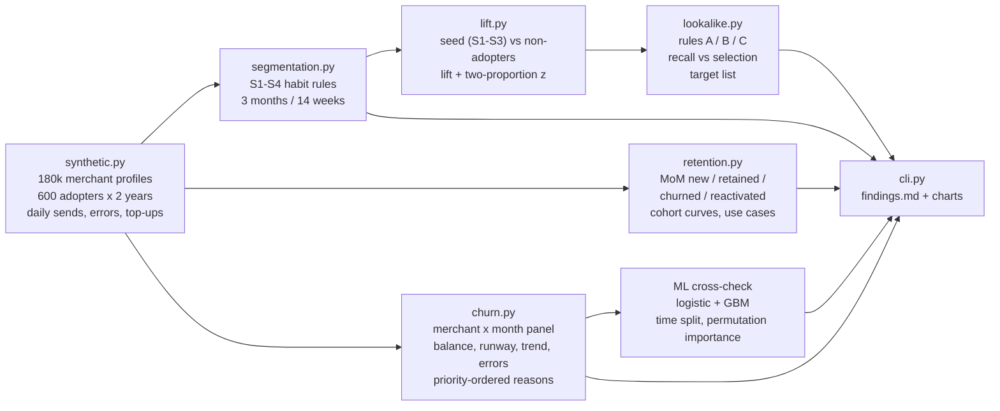
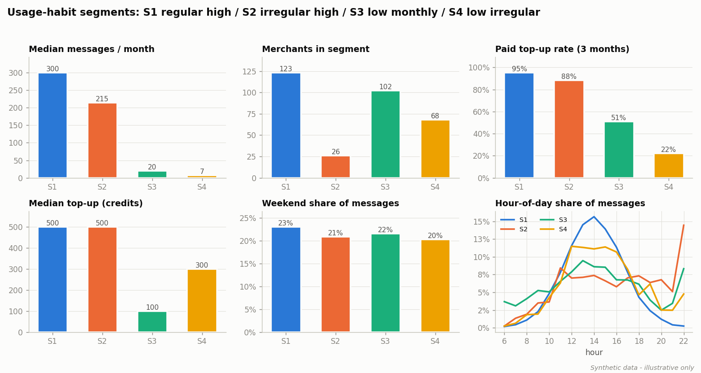
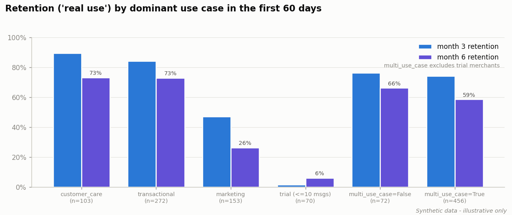
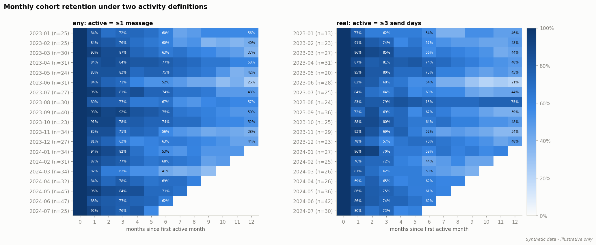
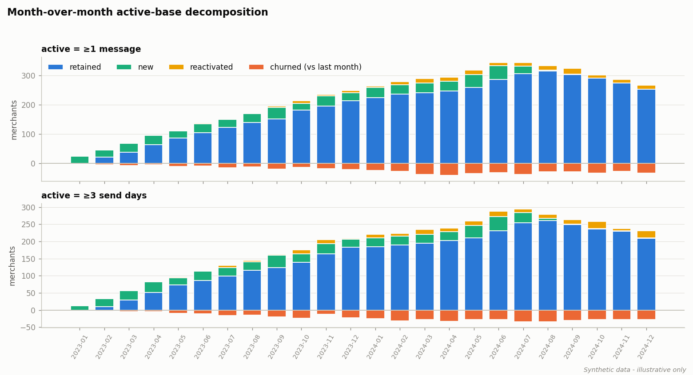
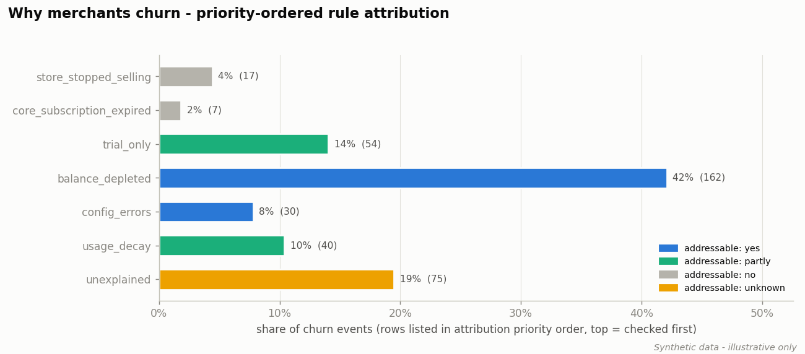
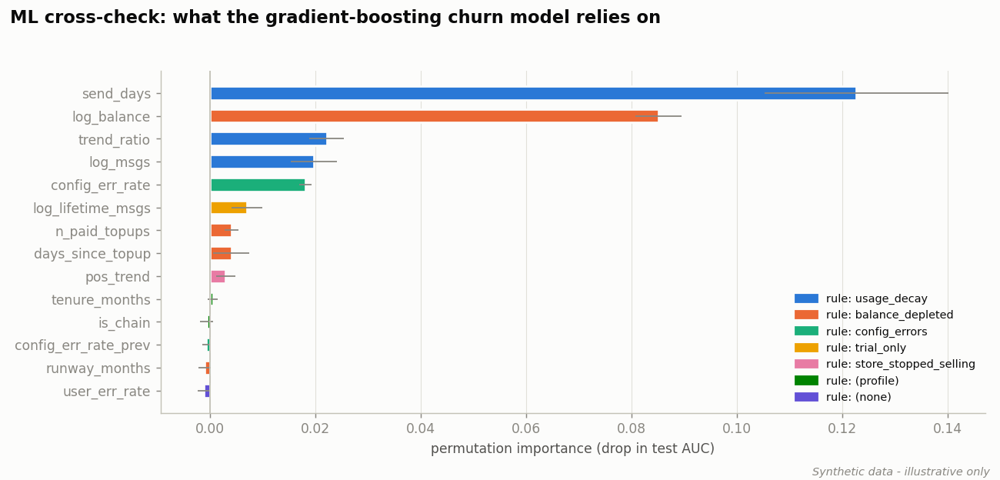
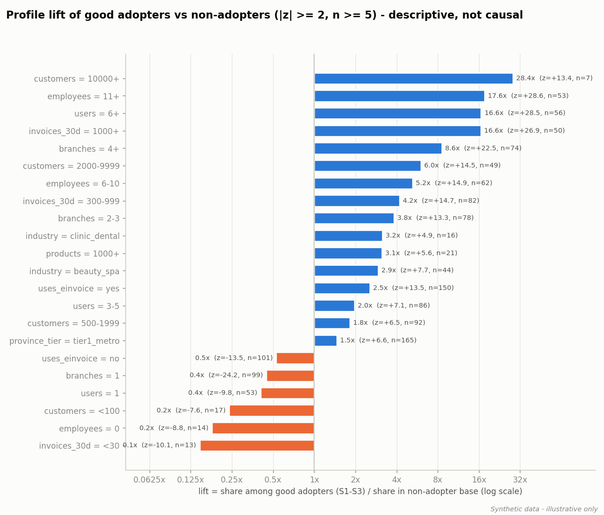
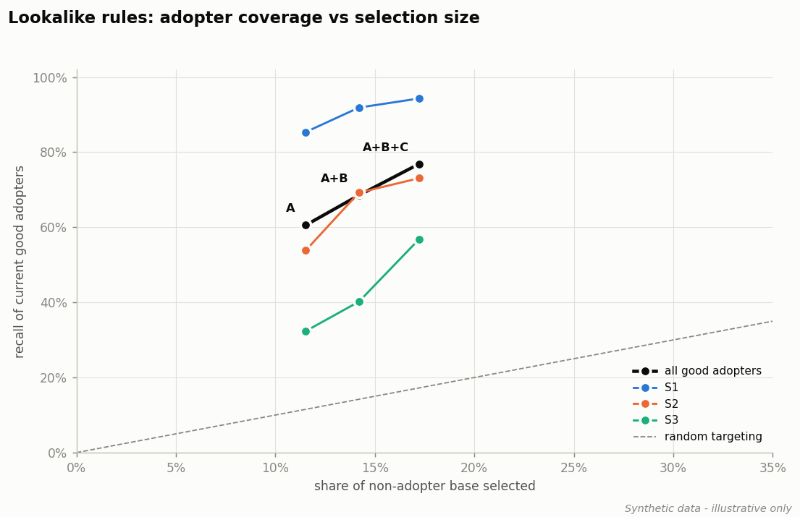

# Add-on retention analytics: usage habits, churn drivers and lookalike targeting

A product-analytics case study for a **prepaid customer-messaging add-on sold inside a POS SaaS**. Merchants top up
credit and use it to send transactional and marketing notifications (order confirmations, appointment reminders,
promotions) to their own customers.

> **Clean-room re-implementation on synthetic data.** The original analysis was work I did on a production data
> platform. This repository rebuilds the method from scratch on a seeded synthetic dataset
> (`addon_analytics/synthetic.py`). It contains no real data, code, names or numbers, and every figure below is synthetic.

## Business questions

1. **Habits:** how do merchants use the add-on, and how do they top up?
2. **Retention:** which use cases keep merchants active?
3. **Churn:** why do merchants stop, and how much of that churn could the add-on team address?
4. **Rollout:** which merchants that have not adopted yet look most like the best adopters?

## Quick start

```bash
pip install -r requirements.txt            # pandas, numpy, scikit-learn, scipy, matplotlib, pytest
python -m addon_analytics.cli all          # ~20 s: data -> analyses -> docs/img/*.png + reports/findings.md
python -m pytest -q
```

Outputs: [`reports/findings.md`](reports/findings.md) (executive memo), CSV tables in `reports/`,
charts in `docs/img/`, and `reports/target_list_top2000.csv` (prioritised rollout targets).

## Methods



| Step | Module | What it does |
|---|---|---|
| Habit segments | `segmentation.py` | **S1** >= 500 messages in 3 months and >= 11 of 14 weeks with >= 2 send days; **S2** high volume, irregular; **S3** low volume, active every month; **S4** low and irregular. Each segment is profiled by messages/month, top-up rate and amount, hour of day, weekend share and use-case mix. |
| Retention | `retention.py` | Month-over-month decomposition under two activity definitions (>= 1 message vs >= 3 send days, "real use"), monthly cohort heatmaps, and retention by the dominant use case in a merchant's first 60 days. |
| Churn | `churn.py` | Churn at M means active in M and silent in M+1 and M+2. Features: estimated balance (cumulative credit minus successful sends), runway in months, 3-month trend ratio, config- and user-error rates, days since the last top-up, lifetime messages. Each churn event gets one **priority-ordered** reason: store stopped selling > core subscription expired > trial only (<= 10 lifetime messages) > balance depleted > config errors > usage decayed > 50% > unexplained. |
| ML cross-check | `churn.py` | Logistic regression and gradient boosting on a time split (last 6 labelled months held out), with test AUC and permutation importance, to check that the rule families match what the data says drives churn. |
| Profile lift | `lift.py` | For every banded profile value, lift = share among good adopters / share among non-adopters, tested with a pooled two-proportion z-test. A value is kept if \|z\| >= 2 and n >= 5. |
| Lookalike rules | `lookalike.py` | Thresholds are read off the lift tables. **A** chains; **B** organised single stores (users, e-invoicing, invoice volume); **C** service businesses with staff. Rules are scored by how many current S1-S3 adopters they cover versus how much of the base they select, and produce a prioritised target list with a suggested use case. |
| SQL | `sql/` | The same logic as DuckDB / Spark SQL reference queries. If `duckdb` is installed, the CLI runs `segmentation.sql` and checks it against pandas. |

## Key findings (synthetic data)

*All numbers come from the seeded synthetic dataset (seed 42) and illustrate the method only.*

**1. Habits.** 123 of the 600 adopters are S1 (regular, high volume): a median of about 300 messages a month,
mostly transactional, and 95% top up. S4 (68 merchants) sends about 7 messages a month and only 22% top up. These
merchants live on the starter credit.



**2. Use cases.** Always-on use cases keep merchants: 6-month "real use" retention is 73% for transactional and 73%
for customer care, against 26% for marketing-led merchants. Merchants whose first 60 days were trial-only almost
never stay (6%). Using several use cases early does not help on its own: what matters is the type of use case.





**3. Churn.** There are 385 churn events over 4.8k labelled active merchant-months (8% a month).
**Half of them (50%) are directly addressable**: the balance ran out with no top-up (about 42%) or template
configuration errors blocked sending (about 8%). Including onboarding and usage decay, 74% are addressable, and
only 6% are exogenous (the store closed or the core subscription lapsed). Because the data is synthetic, the
simulator's true stop reason is known, and the heuristic matches it **87%** of the time. The gradient-boosting
model reaches **test AUC 0.91** (logistic regression 0.88). Its most important features are the balance,
send days / trend and the config-error rate, which are the same families the rules use.




**4. Lookalikes.** Good adopters are heavily over-represented among chains, stores with 6+ users or 11+ employees,
stores with high invoice volume, e-invoicing users and service verticals. Rules A+B+C select **17% of the
non-adopter base** and cover **77% of current good adopters** (94% of S1): a 4.5x concentration.




## Recommendations

1. **Low-balance nudges and auto top-up.** When the remaining credit drops below about one week of typical spend,
   prompt the merchant to top up (one click). This targets the largest churn reason. In the synthetic data, recovering
   30% of these events saves about 36 merchants a year.
2. **Config-error alerting.** When the share of failed sends caused by template configuration exceeds 10%, alert the
   merchant and support and offer a guided fix. These merchants want to send but cannot.
3. **Onboard into always-on flows first.** Set up order and appointment notifications before marketing blasts, and
   contact trial-only merchants within the first week.
4. **Roll out A → B → C** with the suggested use case for each group (A transactional, B marketing, C customer care). Keep a
   random holdout so the descriptive lift can become a measured conversion uplift.
5. **Track "real use"** (>= 3 send days a month) as the health KPI, and use a longer churn window for low-frequency merchants.

## Limitations

- **Lift is descriptive, not causal.** An 8.6x lift for "4+ branches" means such chains are 8.6 times more common
  among good adopters than in the base. It does not mean that targeting them will convert 8.6 times better. That needs an
  experiment or an uplift model.
- **Reason attribution is a heuristic.** Reasons overlap, and the priority order is a judgement call (exogenous
  causes first, then product-addressable ones). The ML cross-check and the synthetic ground truth support it but do
  not prove it.
- **The fixed 2-month churn window misfires for low-frequency merchants.** About 15% of churn events in the
  simulation are natural gaps rather than real stops, and they end up in "unexplained" or "trial only".
- **The balance is estimated** as cumulative credit minus successful sends. A real system also has promotions,
  refunds and credit expiry.
- **Synthetic data contains the mechanisms the analysis looks for.** The value of this repo is the method and
  the code, not the numbers.

## Production version

The production version ran on a **Spark/Hive lakehouse**, queried from Python through **PyHive**. The segmentation,
panel and lift logic ran as Spark SQL over the message logs, and pandas handled the final modelling and reporting.
This repository is a **clean-room rewrite**: the same analytical ideas, re-implemented from scratch on synthetic
data, with the SQL kept as reference queries in `sql/`.

## Repository layout

```
addon_analytics/   synthetic.py, segmentation.py, lift.py, retention.py, churn.py, lookalike.py, plots.py, cli.py, sql_check.py
sql/               reference DuckDB / Spark SQL queries
tests/             pytest: segment rules, z-test, churn definition edge cases, attribution priority, pipeline smoke test
reports/           findings.md (memo), metrics.json, CSV tables, target list
docs/img/          charts used in this README and in the memo
```

## License

MIT, see [LICENSE](LICENSE).
