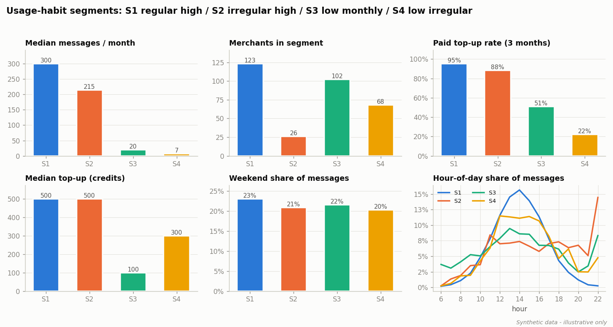
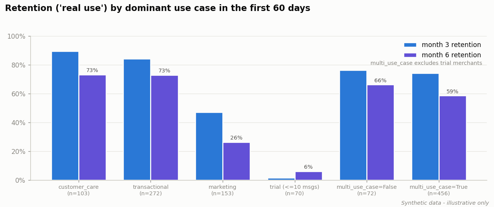
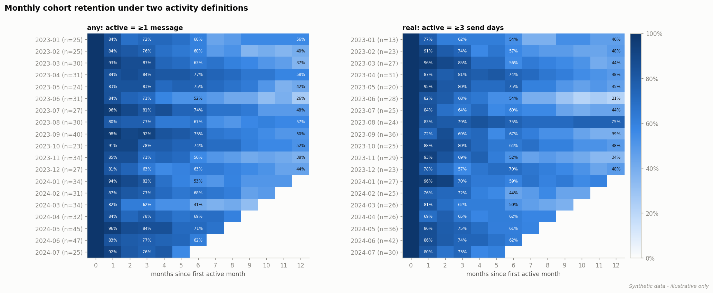
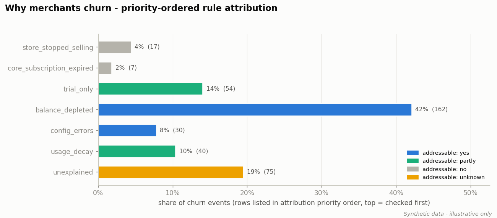
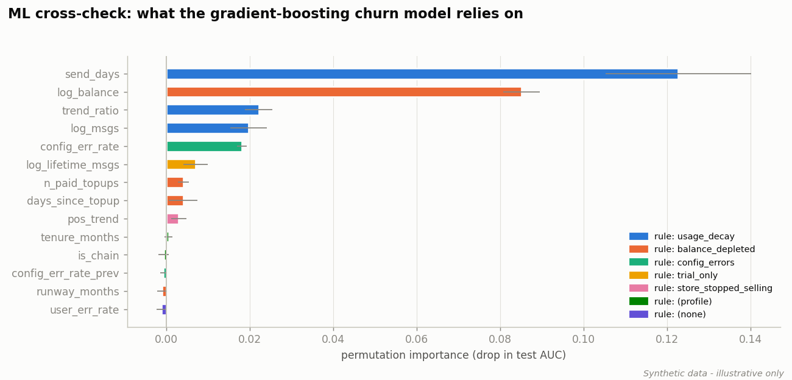
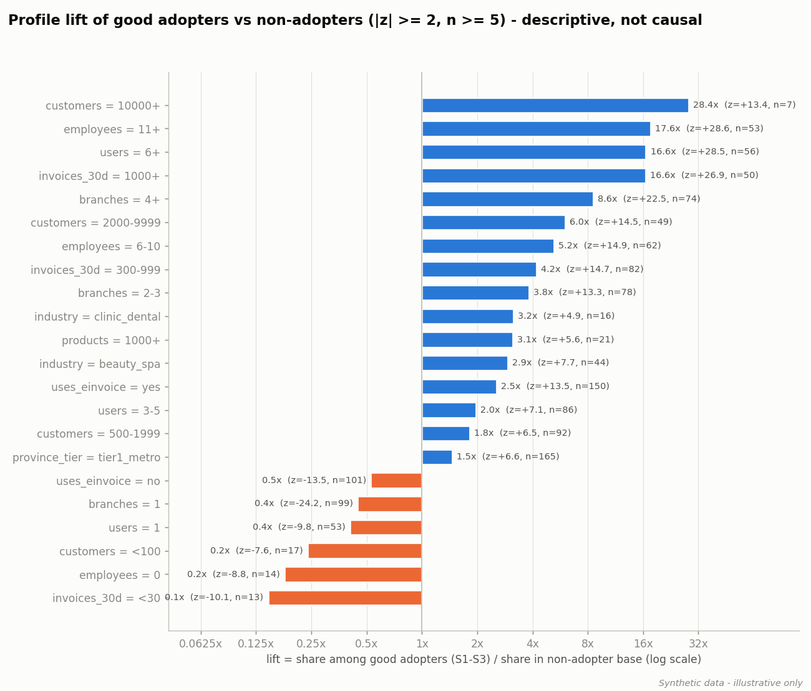
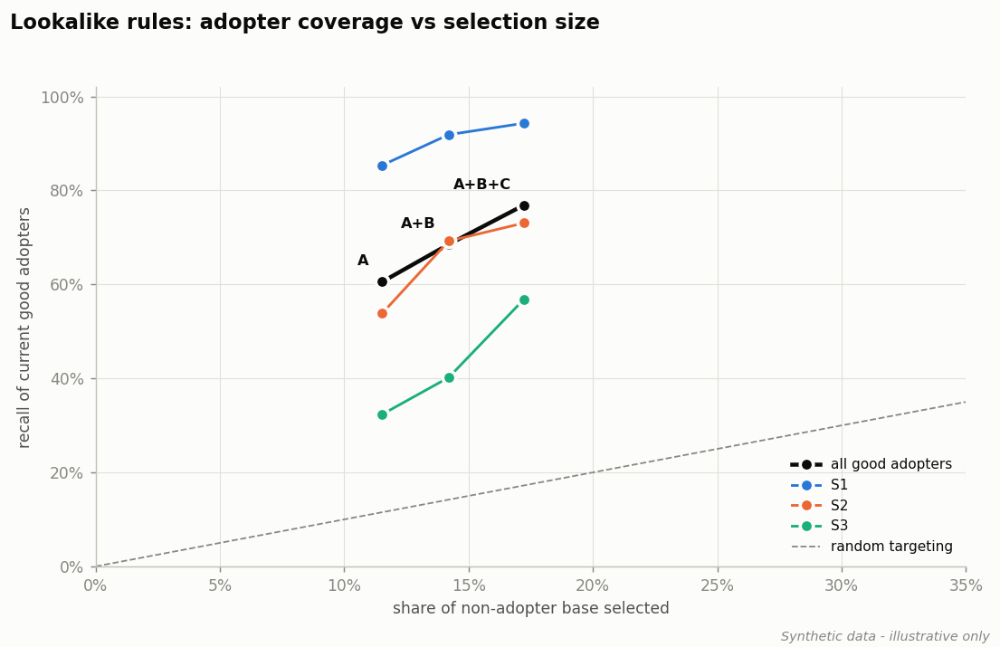

# Findings memo - prepaid messaging add-on: habits, retention, churn, rollout targeting

> **All numbers below come from a seeded SYNTHETIC dataset** generated by `addon_analytics/synthetic.py`.
> They illustrate the method and are not real business results.
> Reproduce with `python -m addon_analytics.cli all`.

## TL;DR

* **600 of 180,000 merchants (0.33%)** use the add-on. In the last 3 months,
  **123 are regular high-volume users (S1)**: median 300 messages/month, 95% top up.
  The long tail (S4, 68 merchants) sends ~7 messages/month and only 22% top up.
* **Always-on use cases retain; campaign-only use does not.** 6-month "real use" retention: transactional 73%,
  customer care 73%, marketing-led 26%. Breadth alone does not help: 2+ early use cases retain 59% vs 66% for single-use-case merchants (trial merchants excluded) - the *type* of use case matters more.
* **50% of churn is directly addressable by the add-on team** (balance ran out and no top-up, or
  blocked by template-configuration errors); 74% including onboarding and usage decay.
  Only 6% is exogenous (store closed / core subscription lapsed).
* **Lookalike rules A+B+C select 17% of non-adopters yet cover 77% of current good
  adopters** (4.5x concentration) -> 30,909 prioritised targets.

## 1. Usage habits and top-up behaviour

Rule-based segments over the 3 months / 14 weeks before 2025-01-01 (S0 = adopters with no message in the window:
281).

| Segment | Merchants | Median msgs / month | Paid top-up rate | Median top-up (credits) | Mean send hour | Weekend share | Mix tx / care / mkt |
|---|---|---|---|---|---|---|---|
| S1 | 123 | 300 | 95% | 500 | 14.0 | 23% | 66% / 20% / 11% |
| S2 | 26 | 215 | 88% | 500 | 15.9 | 21% | 32% / 16% / 49% |
| S3 | 102 | 20 | 51% | 100 | 14.2 | 22% | 42% / 29% / 26% |
| S4 | 68 | 7 | 22% | 300 | 14.8 | 20% | 49% / 17% / 31% |

* S1 is the revenue core: high volume, near-universal top-ups, daytime transactional sends.
* S2 (irregular high volume) is campaign-driven: the highest marketing share and bursty send days.
* S3 is the "reminder" pattern - small but steady monthly volumes; top-ups are small (median 100 credits).
* S4 rarely tops up: these merchants live on the starter credit and are the first to run dry.

## 2. Which use cases drive retention

* Active base at the end of the period: **267** merchants with >=1 message vs **231** with
  >=3 send days ("real use"). Average month-over-month churn over the last 12 months: 11% (any)
  vs 12% (real use). Reactivations are 4% of monthly active merchants,
  so a share of "churn" is really pauses.
* Retention by dominant use case in the first 60 days (6-month, real use): transactional 73%, customer care 73%,
  marketing 26%. Merchants whose first 60 days were trial-only (<=10 messages) almost never stay
  (6% at 6 months).

## 3. Why merchants churn, and how much is addressable

Churn at month M = active in M, nothing in M+1 and M+2. 385 churn events over 4,795 labelled
active merchant-months (8% per month). Reasons are attributed by the first rule that fires:

| Reason (priority order) | Events | Share | Addressable | Lever |
|---|---|---|---|---|
| store_stopped_selling | 17 | 4% | no | none (exogenous) |
| core_subscription_expired | 7 | 2% | no | core-product renewal team |
| trial_only | 54 | 14% | partly | onboarding: first-campaign wizard |
| balance_depleted | 162 | 42% | yes | low-balance top-up nudges / auto top-up |
| config_errors | 30 | 8% | yes | config-error alerting + guided template fix |
| usage_decay | 40 | 10% | partly | re-engagement / use-case expansion |
| unexplained | 75 | 19% | unknown | survey / qualitative follow-up |

**Validation.** Because the data is simulated, the true stop reason is known. Where the simulator recorded a stop event
(n=328), the heuristic picks the true reason **87%** of the time.
15% of "churn" events have no stop event at all - low-frequency merchants whose natural gaps exceed
two months; they land mostly in unexplained (39), trial_only (16), usage_decay (2). This is the main
weakness of a fixed 2-month churn window for low-frequency users.

**ML cross-check.** A gradient-boosting model on a time split (train before 2024-05, test after;
1966 test rows, churn rate 7%) reaches **AUC 0.91**
(logistic regression 0.88). Its top permutation importances map onto the rule families:

| Feature | Importance (AUC drop) | Rule family |
|---|---|---|
| send_days | 0.123 | usage_decay |
| log_balance | 0.085 | balance_depleted |
| trend_ratio | 0.022 | usage_decay |
| log_msgs | 0.020 | usage_decay |
| config_err_rate | 0.018 | config_errors |
| log_lifetime_msgs | 0.007 | trial_only |

**Sizing (scenario, last 12 labelled months 2023-11 .. 2024-10).**

| Lever | Churn events / year | Assumed recovery | Merchants saved / year | Credits retained / year* |
|---|---|---|---|---|
| Low-balance top-up nudge + auto top-up | 121 | 30% | 36 | 54,061 |
| Config-error alerting + guided fix | 23 | 50% | 12 | 5,442 |

\* saved merchants x their average monthly spend in the churn month x 12 months. Recovery rates are
assumptions to be replaced by an A/B test, not estimates.

## 4. Lookalike targeting for the rollout

Lift = share among good adopters (S1-S3) / share among non-adopters, two-proportion z-test, kept if |z| >= 2 and n >= 5.
Strongest over-representation:

| Feature value | Lift | z | n (seed) |
|---|---|---|---|
| employees = 11+ | 17.6x | +28.6 | 53 |
| users = 6+ | 16.6x | +28.5 | 56 |
| invoices_30d = 1000+ | 16.6x | +26.9 | 50 |
| branches = 4+ | 8.6x | +22.5 | 74 |
| employees = 6-10 | 5.2x | +14.9 | 62 |
| invoices_30d = 300-999 | 4.2x | +14.7 | 82 |
| customers = 2000-9999 | 6.0x | +14.5 | 49 |
| uses_einvoice = yes | 2.5x | +13.5 | 150 |

Rules derived from the lift tables (thresholds read off the lowest significantly over-represented band). The suggested
use case is the one most over-indexed in the message mix of the good adopters each rule already covers:

* **A - chains:** >= 2 branches -> suggested use case: **transactional**
* **B - organized single stores:** >= 3 users, e-invoice in use, >= 100 invoices / 30 days -> **marketing**
* **C - service businesses with staff:** beauty_spa, clinic_dental, education_center, pet_services; >= 3 employees and >= 30 invoices / 30 days -> **customer_care**

| Rules | Base selected | Recall of good adopters | Recall S1 / S2 / S3 | Concentration |
|---|---|---|---|---|
| A | 12% (20,675) | 61% | 85% / 54% / 32% | 5.3x |
| A+B | 14% (25,471) | 69% | 92% / 69% / 40% | 4.8x |
| A+B+C | 17% (30,909) | 77% | 94% / 73% / 57% | 4.5x |

The top 2,000 targets are in `reports/target_list_top2000.csv` (priority A > B > C, then lift score).

## Recommendations

1. **Low-balance nudges and one-click / auto top-up.** Trigger when runway < ~1 week of typical spend; "balance ran out
   and no top-up" is the single largest churn reason (42%).
2. **Config-error alerting.** Alert the merchant (and support) when the template-configuration failure rate exceeds 10%
   in a day; offer a guided fix. These merchants want to send but cannot.
3. **Onboard into always-on flows first.** Transactional and customer-care merchants retain best;
   set up order and appointment notifications before marketing blasts, and follow up trial-only merchants within the first week.
4. **Roll out to A -> B -> C segments**, with the suggested use case in the pitch, and measure with a holdout so the
   descriptive lift can be turned into a causal conversion estimate.
5. **Use "real use" (>=3 send days) as the health KPI** and a longer churn window for low-frequency merchants.

## Limitations

* Lift is **descriptive over-representation, not causal uplift**; targeting effects need an experiment.
* Churn-reason attribution is a **priority-ordered heuristic**; reasons overlap and the order is a judgement call.
* The balance is *estimated* (cumulative credits - successful sends); real systems may have promos, refunds and expiry.
* Synthetic data encodes the mechanisms the analysis looks for; the value here is the method, not the numbers.

_Optional SQL cross-check: skipped (No module named 'duckdb')_
